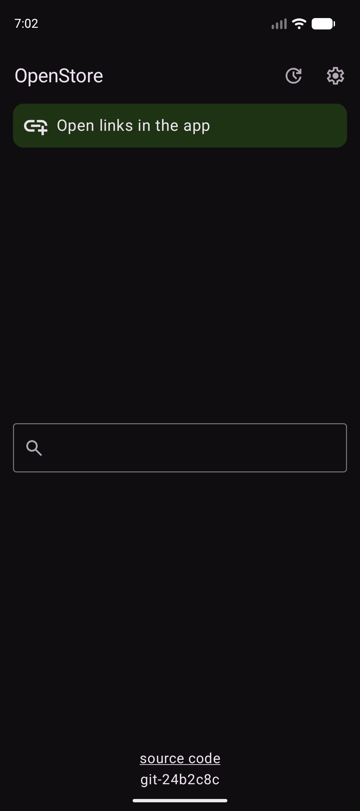
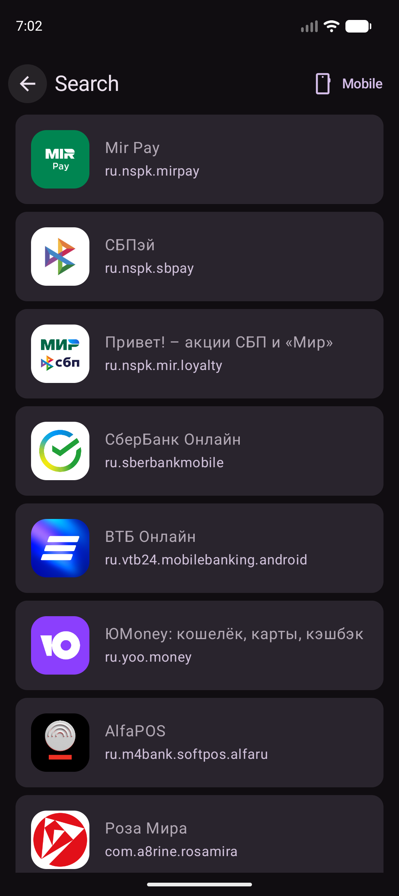
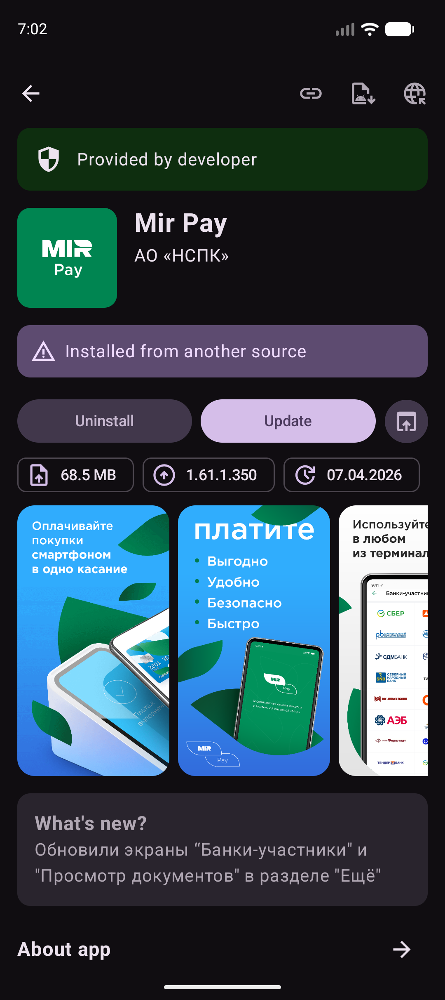
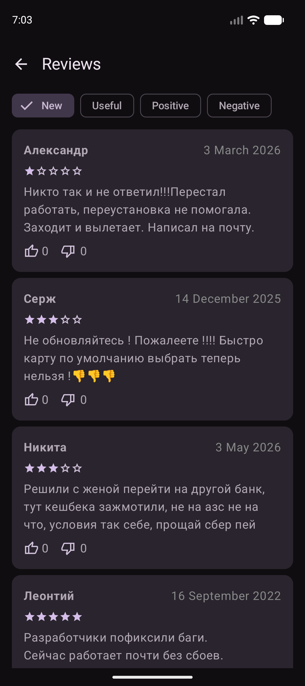
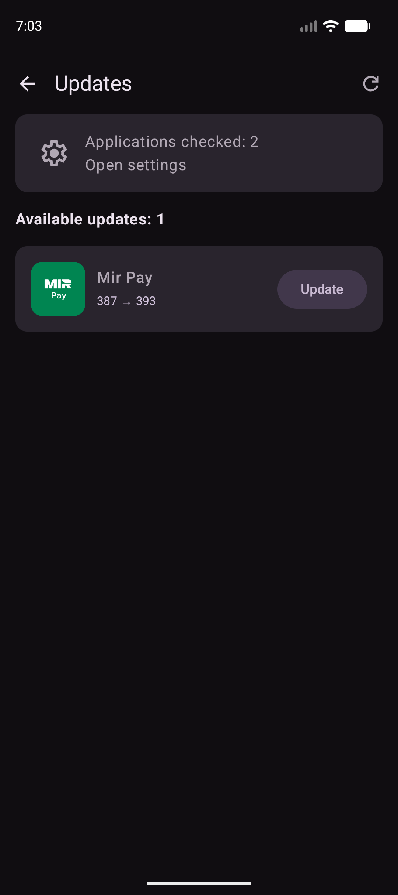
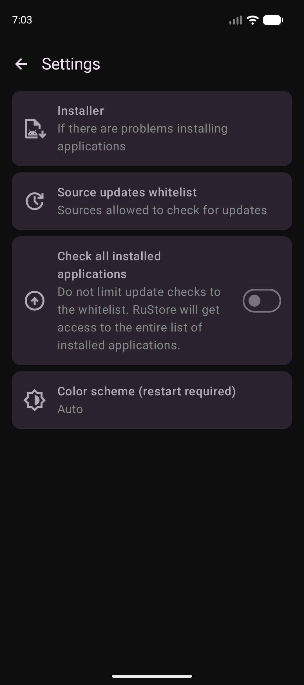

# OpenStore

---

Open client for popular russian app store (unofficial)

## Installation

Verification info:
- Package ID: `dev.mi6e4ka.openstore`
- SHA-256 hash of signing certificate: `57:F7:EA:8B:41:B7:2E:6E:CF:C5:08:46:AF:ED:12:01:47:1A:8D:37:8E:18:D7:6A:AD:AC:BD:9F:B2:19:DF:98`

## Features
- [x] Search apps
- [x] View apps descriptions, rating and reviews
- [x] Native app installing
- [x] Android 5.0+ support!
- [x] Search and view TV apps
- [x] Check all apps for updates

## Roadmap
- [ ] Better TV navigation support
- [ ] ...maybe more?

## Screenshots

 

## Building the app
See [here](https://codeberg.org/mi6e4ka/openstore/src/branch/main/BUILDING.md)
